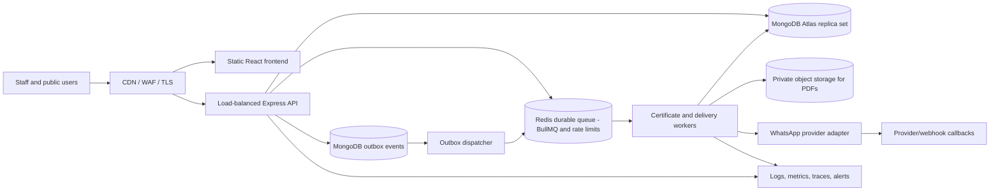

# CertiFlow Deployment Plan

This plan is designed for approximately 100,000 registered users, 10,000 daily active users, bursty public verification, and a results-day peak of 500 approved batches in one hour (about 30,000 certificates and 30,000 WhatsApp deliveries).

The deployment target is a managed cloud environment. Exact provider products can be substituted, but the responsibilities and capacity boundaries should remain the same.

## Architecture

The API writes the batch decision, audit record, certificate state, and outbox event in one MongoDB transaction. The dispatcher publishes durable jobs to Redis. Workers generate PDFs, store them privately, and deliver WhatsApp messages. Every job has a deterministic ID and every write is idempotent, so retries cannot create a second certificate or second delivery.

## Hosting and sizing

| Component | Production hosting | Initial sizing and reason |
| --- | --- | --- |
| React frontend | Object storage + CDN (for example, S3/CloudFront or equivalent) | Static assets scale at the edge and do not consume API capacity. |
| API | Managed container service behind HTTPS load balancer, minimum 2 instances | Stateless Express instances scale horizontally on CPU, request rate and active SSE connections. |
| Certificate workers | Separate managed containers, minimum 2 worker processes | Scale independently from API; add workers for the results-day queue. |
| MongoDB | Managed replica set, 3 nodes, automated backups and point-in-time recovery | Transactions, unique indexes and failover are required. Start around 4–8 vCPU/16–32 GB RAM and benchmark. |
| Redis | Managed Redis with persistence, replicas and automatic failover | BullMQ scheduling/retries require low latency and durable queue state. |
| PDF storage | Private object-storage bucket with versioning and lifecycle rules | Keeps large files out of MongoDB and scales independently. |
| Observability | Managed logs/metrics/traces | Centralizes API, worker, queue and database signals. |

Run API and worker images in separate autoscaling groups. Deploy in at least two availability zones. Put MongoDB, Redis and the object-storage endpoint behind private networking where the provider supports it.

## Scaling and peak throughput

- API instances scale horizontally. Public verification is read-only and can be cached briefly at the CDN/API edge by token, with `no-store` retained for sensitive responses where required.
- Workers scale on queue depth and job age. A results-day target is 30,000 PDF jobs plus 30,000 delivery jobs in one hour. With 30 workers processing one job every 3–5 seconds, theoretical capacity is approximately 21,600–36,000 jobs/hour per job class; provision separate PDF and delivery worker pools and load-test before the event.
- PDF generation is CPU-bound, so PDF workers are the first throughput limit. Delivery workers are primarily provider-rate-limit and network bound.
- The WhatsApp provider's contracted rate limit is the external ceiling. The queue absorbs bursts instead of blocking approval requests. The UI displays `queued`, `processing`, `retrying`, `sent`, and `failed` states.
- Use deterministic BullMQ job IDs, MongoDB unique indexes, and idempotent state transitions. This guarantees one certificate per candidate enrollment and one logical delivery even when a job is retried.
- Keep a queue-depth budget and pre-scale workers before results day. After the peak, workers continue draining the backlog until the oldest job returns below the SLA target; temporarily increase concurrency only within provider and database limits.

## Failure handling

### Worker crash

BullMQ locks expire and jobs become available again. A supervisor restarts the container, while attempts/backoff move repeatedly failing jobs to a dead-letter/failed view. Certificate creation is transactionally idempotent, so a restarted worker resumes safely.

### Redis restart

Use AOF/persistence and managed failover. Workers reconnect with exponential backoff. The MongoDB outbox remains the source of truth; a replay command can republish undispatched events after Redis recovery. Do not approve a batch by relying only on an in-memory queue acknowledgment.

### WhatsApp outage or timeout

The provider adapter uses timeouts, exponential backoff and a maximum attempt count. A lost response is reconciled with the provider idempotency key before sending again. Jobs remain `retrying` or `failed` and are visible to the state office; certificates remain valid even when delivery is delayed.

### Slow database

Use connection-pool limits, query timeouts, pagination, projections and indexes for batch state, certificate token, audit and outbox queries. Autoscaling alerts fire on latency and pool saturation. API instances return a controlled 503 for overloaded writes rather than creating partial state. MongoDB replica-set failover and point-in-time backups provide recovery.

## Certificate storage and access control

- Store PDFs in a private, encrypted object-storage bucket; do not expose public bucket URLs.
- Store only the object key, checksum, certificate number, status and metadata in MongoDB.
- API download endpoints verify the signed application token, certificate status and expiry, then issue a short-lived (for example, 10-minute) signed object URL or stream the file.
- Revoked certificates immediately fail verification and download authorization. Previously downloaded files cannot be recalled, but new access is blocked.
- Restrict bucket access to the worker/API service identity. Use separate read/write policies, key rotation, TLS in transit and provider-managed encryption at rest.
- Public verification returns only the minimum fields needed to confirm authenticity (status, certificate number, masked name, course, centre and dates). Staff endpoints require JWT authentication and role/ownership checks.

## Monitoring and alerting

Collect structured JSON logs with correlation ID, batch ID, certificate ID and job ID. Track:

- API latency/error rate, request volume, authentication failures and active SSE connections.
- Queue depth, oldest job age, retry count, failed/dead-letter jobs, worker heartbeats and PDF generation duration.
- WhatsApp acceptance latency, provider error/timeout rate and delivery success rate.
- MongoDB operation latency, replication lag, connections, CPU, storage and index/query performance.
- Redis memory, persistence status, replication/failover events and rejected commands.
- Object-storage errors, signed-link failures and bucket growth.
- SLA escalations, batches stuck in a review stage and certificates revoked.

Page the on-call owner for API availability, queue age above the issuance SLA, worker absence, provider outage, database failover/lag, Redis persistence failure and storage access errors. Use dashboards for trends and a runbook for replaying outbox events and safely increasing worker capacity.

## Rough monthly cost

Indicative USD/month for a small production deployment (prices vary by region, provider and traffic):

| Area | Estimate |
| --- | ---: |
| API and frontend hosting/load balancer/CDN/WAF | $100–$250 |
| Autoscaled certificate and delivery workers | $150–$500 normally; $300–$900 during a peak month |
| MongoDB managed replica set with backups | $300–$800 |
| Managed Redis with persistence/replica | $80–$250 |
| Object storage, egress and lifecycle backups | $30–$150 |
| Logs, metrics, tracing and alerting | $75–$250 |
| **Estimated total** | **$735–$2,200/month** |

The lower end uses modest baseline capacity and scales workers only for results day. The higher end buys more database headroom, retained logs, multi-zone redundancy and faster backlog drain. A single large always-on cluster would be simpler but costs more when idle; autoscaling and managed services trade some provider dependency for lower operational effort and easier failover.

## Rollout and capacity validation

1. Load-test public verification bursts and authenticated review traffic.
2. Generate and deliver at least 30,000 synthetic jobs using the mock provider, measuring queue age, MongoDB load and provider throttling.
3. Test worker termination, Redis failover, provider timeouts, database failover and replayed outbox events.
4. Confirm unique certificate/delivery invariants and revocation behavior under retries.
5. Pre-scale workers, verify alerts/runbooks, and take a database backup before results day.

